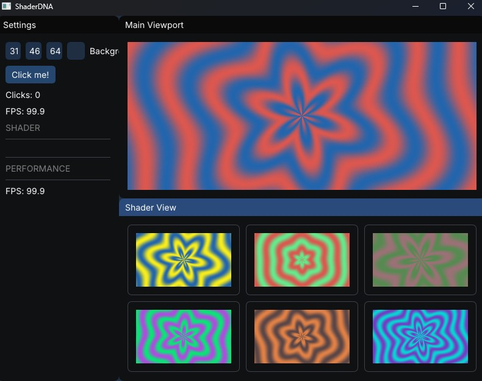

# ShaderDNA

**Procedural shaders meet genetic algorithms.**


## About

## Preview



ShaderDNA is an experimental graphics application that combines real-time procedural shader rendering with concepts inspired by genetic algorithms.

Instead of manually designing every visual pattern, ShaderDNA represents shader parameters as digital DNA. By generating randomized genomes and combining their attributes through genetic crossover, the application explores new visual variations.

The project brings together computer graphics, evolutionary computation, and generative art in an interactive desktop application.

## Features

- Real-time procedural shader rendering
- Randomized shader DNA generation
- Genetic crossover between shader genomes
- Animated procedural patterns
- Six parent shader previews
- Dedicated offspring shader viewport
- Independent framebuffer rendering
- Resizable shader viewports
- Dear ImGui user interface
- FPS monitoring
- Dark mode interface

## How It Works

Each shader is represented by a genome containing several visual parameters.

| Gene | Description |
|---|---|
| Frequency | Controls the density of procedural patterns |
| Distortion | Defines the deformation of visual patterns |
| Speed | Controls animation speed |
| Color A | First color of the shader |
| Color B | Second color of the shader |

The generation process consists of the following steps:

1. Generate a randomized population of shader genomes.
2. Select individual genes from the population.
3. Combine inherited genes into a new offspring genome.
4. Upload the genome parameters to the GPU as shader uniforms.
5. Render the parent shaders and their offspring in real time.

Mutation is currently under development and is intended to introduce additional genetic variation.

## Technology Stack

| Technology | Purpose |
|---|---|
| C++ | Core application logic |
| OpenGL 3.3 | Real-time graphics rendering |
| GLSL | Procedural shader programming |
| GLFW | Window and context management |
| GLAD | OpenGL function loading |
| GLM | Mathematical operations |
| Dear ImGui | Graphical user interface |
| CMake | Build system |

## Getting Started

### Requirements

- Windows
- Visual Studio with Desktop Development with C++
- C++ compatible compiler
- CMake 3.24 or newer
- Ninja
- Git
- OpenGL 3.3 compatible GPU
- Internet connection for initial dependency downloads

### Build

Open the repository folder in Visual Studio and select the `x64-release` or `x64-debug` CMake preset.

Alternatively, run the following commands from a Visual Studio developer environment:

```bash
cmake --preset x64-release
cmake --build out/build/x64-release
```

GLFW, GLM, and Dear ImGui are automatically downloaded using CMake FetchContent. GLAD is included in the repository.

### Usage

Launch ShaderDNA to generate a randomized shader population and visualize the resulting offspring.

The interface consists of three main sections:

- **Settings:** Background color and performance information.
- **Main Viewport:** Real-time rendering of the generated offspring.
- **Shader View:** Six parent shader previews.

Press `ESC` to close the application.

## Project Structure

```text
ShaderDNA/
├── CMakeLists.txt
├── CMakePresets.json
└── ShaderDNA/
    ├── Main.cpp
    ├── Renderer.cpp
    ├── Renderer.h
    ├── Genome.cpp
    ├── Genome.h
    ├── DNA.h
    ├── GUI.cpp
    ├── GUI.h
    ├── Framebuffer.h
    ├── ShaderLoader.h
    ├── Shaders.h
    ├── utils.h
    ├── shader/
    │   ├── shader.vert
    │   └── shader.frag
    ├── assets/
    ├── external/
    └── CMakeLists.txt
```

## Roadmap

Potential future improvements:

- [x] OpenGL rendering pipeline
- [x] Procedural GLSL shaders
- [x] Randomized DNA population
- [x] Genetic crossover
- [x] Multiple shader viewports
- [x] Dear ImGui integration
- [ ] Functional genetic mutation
- [ ] Interactive parent selection
- [ ] Multiple evolutionary generations
- [ ] Adjustable mutation rate and strength
- [ ] Interactive gene editing
- [ ] Additional procedural shader types
- [ ] Genome saving and loading
- [ ] Image export
